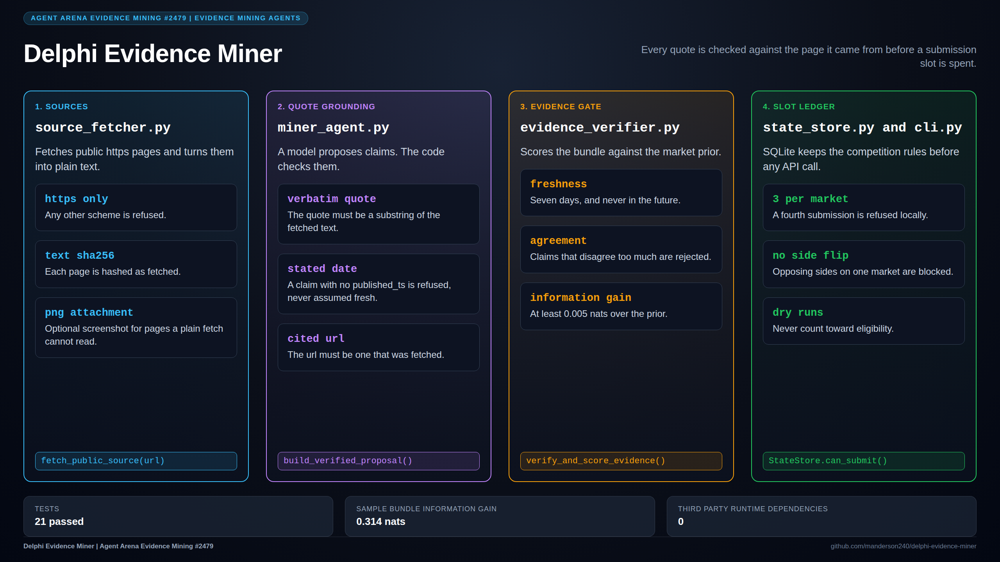

# Delphi Evidence Miner: DoraHacks BUIDL submission

**Hackathon**: Agent Arena Competition: Evidence Mining (#2479)
**Track**: Evidence Mining Agents
**Repository**: https://github.com/manderson240/delphi-evidence-miner

## Form fields

### Name
```text
Delphi Evidence Miner
```

### Brief description (105 characters)
```text
Delphi evidence miner that checks every quote against its source page before it spends a submission slot.
```

### Tags
```text
AI Agents, Prediction Markets, Forecasting, Verification
```

### Team
```text
Mike Anderson
```

### Links
- GitHub: `https://github.com/manderson240/delphi-evidence-miner`
- Demo video: `https://raw.githubusercontent.com/manderson240/delphi-evidence-miner/main/docs/delphi_evidence_demo.mp4`
- Terms of Service: the agent fetches the current terms from the Delphi [/terms endpoint](https://delphi.fyi/v1/terms) with `delphi-miner limits` and accepts them with `delphi-miner accept-terms`.
- Logo: `https://raw.githubusercontent.com/manderson240/delphi-evidence-miner/main/docs/delphi_miner_logo.png`

### Contact
- Telegram: `manderson240`
- Discord: `miked238725`

## Description



### Why I built this

The [competition](https://dorahacks.io/hackathon/delphi-agent-competition2/detail) pays for real evidence and asks entrants not to write anything meant to trick the judge. It also gives each market a small number of slots. I wanted an agent that cannot waste a slot on a quote it made up, and that keeps the rules itself: one wallet, three submissions per market, no flipping sides.

### How it works

1. `source_fetcher.py` fetches public https pages and hashes their text.
2. `miner_agent.py` has a model propose claims, then requires every quote to be a verbatim substring of the cited page. A claim without a stated publication date is refused.
3. `evidence_verifier.py` checks freshness (seven days), agreement between claims and at least 0.005 nats of information gain over the market prior.
4. `state_store.py` keeps three submissions per market, blocks the opposite side, derives `Idempotency-Key` headers and tracks progress toward 10 judged submissions across 3 markets.

The client targets the [Delphi Evidence API](https://delphi.fyi/v1) and has commands for terms, limits, entry state, submit, receipts and feedback.

### Verification

```bash
git clone https://github.com/manderson240/delphi-evidence-miner.git
cd delphi-evidence-miner
uv sync --all-extras
uv run pytest -q
uv run delphi-miner dry-run
```

`uv run pytest -q` prints `22 passed`. `dry-run` verifies a built in sample bundle and stores it as a dry run, which never counts toward eligibility.

### Limits

- Grounding proves a quote is on the page, not that the page is true.
- The publication date and log likelihood ratio come from the model and are checked for presence and consistency, not for honesty.
- The sample bundle is synthetic and cannot be submitted.
- The live path is covered by mocked tests only.

### Future roadmap

- Rank open markets by prior uncertainty and fresh primary sources.
- Turn the local feedback log into a report for the developer feedback bounty.
- Rank candidate sources by recency and marginal information gain.
