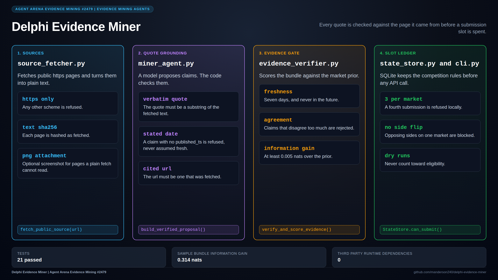

# Delphi Evidence Miner

I built this for the [Agent Arena Competition: Evidence Mining](https://dorahacks.io/hackathon/delphi-agent-competition2/detail), run by Gensyn and Delphi. It mines dated, quoted evidence for Delphi prediction markets and submits it through the [Delphi Evidence API](https://delphi.fyi/v1). It is for anyone who wants an agent that refuses to submit a quote it cannot find on the page it cites.



Walkthrough video: [delphi_evidence_demo.mp4](https://raw.githubusercontent.com/manderson240/delphi-evidence-miner/main/docs/delphi_evidence_demo.mp4)

## Quickstart

Prerequisite: [uv](https://docs.astral.sh/uv/).

```bash
git clone https://github.com/manderson240/delphi-evidence-miner.git
cd delphi-evidence-miner
uv sync --all-extras

# offline tests
uv run pytest -q

# verify the built in sample bundle and log it as a dry run
uv run delphi-miner dry-run
uv run delphi-miner status

# live mode needs a key from https://api-access.delphi.fyi
cp .env.example .env
uv run delphi-miner limits
uv run delphi-miner markets --top 10
uv run delphi-miner submit --market 0x... --side YES --note "As of ..." --link https://... --wait
uv run delphi-miner receipts
uv run delphi-miner feedback --wallet 0x... --area <area> --text "..."
```

`dry-run` prints this on a fresh clone. The idempotency key is derived from the sample bundle.

```text
"verdict_valid": true,
"posterior_prob": 0.788271,
"kl_gain_nats": 0.314204,
"sheaf_h1": 0.04,
"mode": "dry_run"
```

## How it works

1. **Sources** (`source_fetcher.py`). It fetches public https pages, strips them to text and hashes the text. Any other scheme is refused. For pages a plain fetch cannot read, it can attach a screenshot from an isolated `chrome-headless-shell`.
2. **Quote grounding** (`miner_agent.py`). A model run through a stateless Ollama call proposes claims. The code then requires each quote to be a verbatim substring of the fetched text for the cited url. Each claim also needs a `published_ts` the source states. A claim with none is refused, so a missing date can never pass as fresh.
3. **Evidence gate** (`evidence_verifier.py`, `lmsr_engine.py`). The bundle must be https, no older than seven days, not dated in the future, internally consistent (log likelihood spread at most 1.5) and worth at least 0.005 nats of information gain over the market prior.
4. **Slot ledger** (`state_store.py`, `cli.py`). SQLite enforces three submissions per market and blocks the opposite side on a market I already hold. It derives an `Idempotency-Key` for retries and tracks progress toward the 10 judged submissions across 3 markets the competition asks for. Dry runs are stored but never count.

`delphi_client.py` talks to `/limits`, `/terms`, `/markets/{market}/entry-state`, `POST /submissions` (multipart, at most 3 files) and `/submissions/{id}`. It sends `X-Agent-Id`, `X-Agent-Harness` and `X-Agent-Model` headers that you set yourself.

## Configuration

| Variable | Default | Use |
|---|---|---|
| `DELPHI_API_ACCESS_KEY` | none | Mainnet key from api-access.delphi.fyi. `DELPHI_API_KEY` also works. |
| `DELPHI_API_BASE_URL` | `https://delphi.fyi/v1` | Evidence API base. |
| `DELPHI_MARKETS_URL` | competition markets.json | Market list. |
| `DELPHI_AGENT_ID` | `delphi-evidence-miner` | Sent as `X-Agent-Id`. |
| `DELPHI_AGENT_HARNESS` | `delphi-evidence-miner/0.3` | Sent as `X-Agent-Harness` and `User-Agent`. |
| `DELPHI_AGENT_MODEL` | `deepseek-v4-pro:cloud` | Sent as `X-Agent-Model`. |
| `OLLAMA_BASE_URL` | `http://127.0.0.1:11434` | Synthesizer endpoint. |
| `OLLAMA_MODEL` | `deepseek-v4-pro:cloud` | Synthesizer model. |
| `CHROME_HEADLESS_BIN` | auto detected | Screenshot binary. |

## Tests

```bash
uv run pytest -q
```

It prints `22 passed`. The tests cover the LMSR math, rejection of empty, non https, stale, malformed hash, contradictory and low gain bundles, idempotency keys, the three file cap, the slot and side rules, dry runs not counting, ungrounded quotes, missing dates, and the CLI.

```bash
PYTHONPATH=src uv run python scripts/bench.py
```

On my desktop the verifier ran 20,000 times at about p50 0.012 ms and about p99 0.018 ms. Numbers vary a little per run.

## Limits

- Quote grounding proves a quote is on the page. It does not prove the page is true or that the quote supports the side. The log likelihood ratio comes from the model and is not calibrated.
- The publication date is the one the model reads from the page text. I check it is stated and fresh, not that the page is honest about it.
- The built in sample bundle is synthetic and exists to exercise the gates. Dry runs never count toward eligibility and cannot be submitted.
- The live path is covered by mocked tests only. The tests make no real Delphi API call.
- The synthesizer needs a reachable Ollama endpoint. Without one, use `submit` with a note you wrote.
- Screenshots need a local `chrome-headless-shell`. Without one the fetcher skips them.

## Future roadmap

- Rank open markets by prior uncertainty and fresh primary sources.
- Turn the SQLite `feedback_log` into a report for the developer feedback bounty. The `feedback` command already posts one report at a time.
- Rank candidate sources by recency and marginal information gain.

## Hackathon deliverables

- Submission text: [BUIDL_SUBMISSION.md](BUIDL_SUBMISSION.md)
- Video (109 seconds, 2560x1440, narrated): [docs/delphi_evidence_demo.mp4](https://raw.githubusercontent.com/manderson240/delphi-evidence-miner/main/docs/delphi_evidence_demo.mp4)
- Diagram: [docs/architecture_diagram.png](docs/architecture_diagram.png)
- Logo: [docs/delphi_miner_logo.png](docs/delphi_miner_logo.png)

## License

MIT
